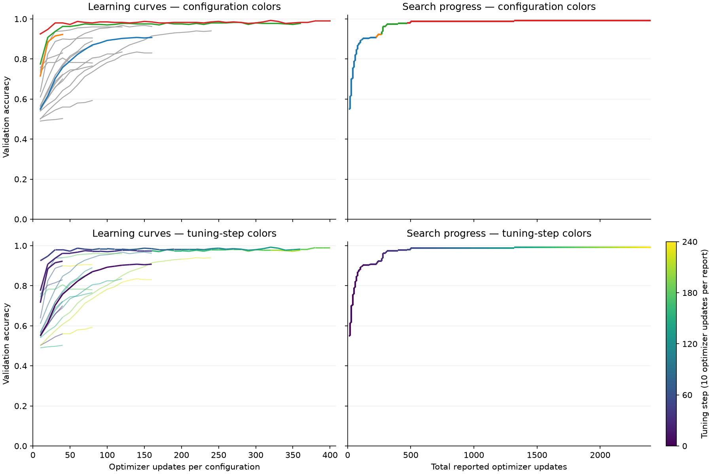

<h1> ICICLE</h1>

**In-Context Inference for Curve-Learning Extrapolation.**

ICICLE predicts how partially observed learning curves continue, helping a
freeze-thaw optimizer choose which configurations to train further. Use it with
Ray Tune to pause and resume trials, or call the surrogate directly. The included
model was trained on synthetic curves and runs through ONNX Runtime.

## Install

From this repository, using [uv](https://docs.astral.sh/uv/getting-started/installation/):

```bash
uv venv --python 3.12
source .venv/bin/activate
uv pip install '.[ray]' matplotlib
```

Or use pip with Python 3.12 or newer:

```bash
python3.12 -m venv .venv
source .venv/bin/activate
python -m pip install '.[ray]' matplotlib
```

For prediction without Ray, install `.[serving]` instead; Matplotlib is only needed
for the examples. Install from this repository: the PyPI package named `icicle`
is unrelated.

## Run freeze-thaw HPO

```bash
python examples/raytune_freeze_thaw.py
```

This CPU example shares a training budget across configurations, saves checkpoints,
and resumes promising trials. Results and search plots are saved under `ray_results/`.
For parallel trials, run `python examples/raytune_concurrent.py`.

The default run produces learning curves and search progress like this. Colors
track configurations (top) and evaluation order (bottom).



[View output from the three-worker example.](examples/raytune_concurrent.png)

To adapt the [example](examples/raytune_freeze_thaw.py):

- Define your search space and report a metric after each training step or epoch.
- Save and restore training state, including the optimizer and random state.
- Set the metric and fidelity grid on `IcicleFreezeThawScheduler`.

The default metric is a maximized score in `[0, 1]`. For another scale or direction,
pass a `MetricMap` as the scheduler's `metric_map` argument:

```python
from icicle.hpo.metric_map import MetricMap

loss_map = MetricMap(best=0, maximize=False)  # Nonnegative loss
adaptive_map = MetricMap()                  # Maximized score, learned bounds
```

Missing bounds are fitted from observed metrics. With Ray's function API, report a
checkpoint at every possible pause point; the example uses the class API.
See Ray's [checkpointing](https://docs.ray.io/en/latest/tune/tutorials/tune-trial-checkpoints.html)
and [logging](https://docs.ray.io/en/latest/tune/api/logging.html) guides for integration details.

## Predict a learning curve

```python
import numpy as np
from icicle.serving import OnnxSurrogate

predict = OnnxSurrogate(intra_op_num_threads=2)  # Bundled pretrained model
probs = predict(
    ctx_hps=np.array([[0.2, 0.7], [0.2, 0.7]]),
    ctx_fid=np.array([0.1, 0.2]),
    ctx_y=np.array([0.45, 0.55]),
    qry_hps=np.array([[0.2, 0.7]]),
    qry_fid=np.array([1.0]),
)
centers = (predict.borders[:-1] + predict.borders[1:]) / 2
print("Predicted final value:", float(probs[0] @ centers))
```

Inputs use the model's normalized `[0, 1]` representation; larger observed values
mean better performance. At least one observation is required. Predictions are
probability masses over `predict.borders`. To use another exported model, pass its
`.onnx` path; the matching `.json` metadata must be alongside it.

## Training and reproduction

See [training and paper experiments](reproduction/README.md) for training, export,
benchmark preparation, evaluation and figures. Development dependencies are
`.[dev,train,export,ray,experiments]`.

## License and citation

ICICLE code and model weights use the [MIT License](LICENSE). Third-party models
and datasets retain their own licenses; see [third-party notices](THIRD_PARTY_NOTICES).
Citation metadata is in [CITATION.cff](CITATION.cff).
